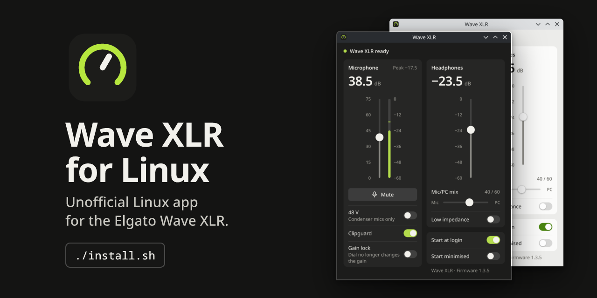
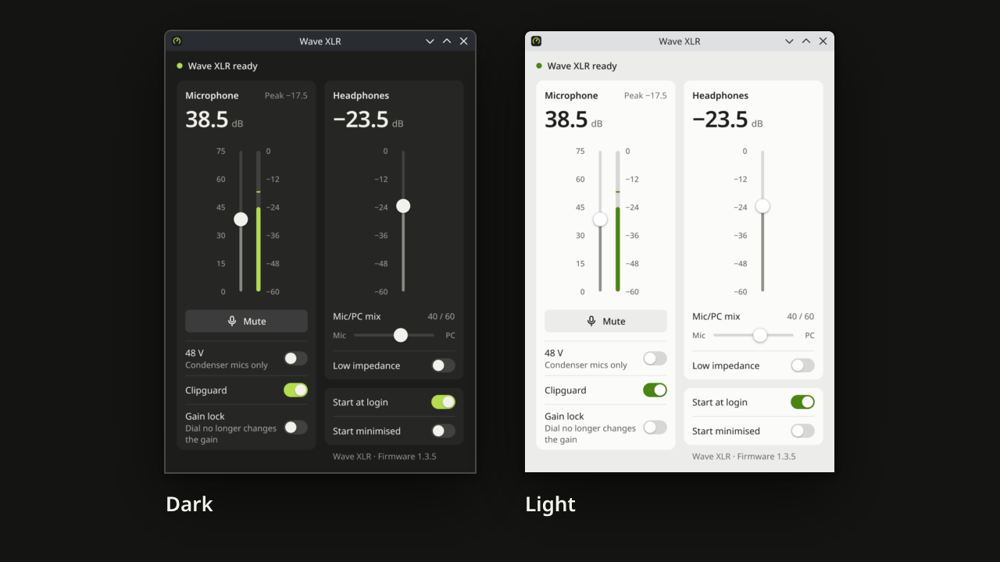

# Wave XLR for Linux

An unofficial control app and level memory for the Elgato Wave XLR on Linux. It sets your levels again whenever the
device comes back, and gives you its settings in a small window.

> Not an official Elgato product, and not affiliated with or endorsed by Elgato or Corsair. "Wave XLR" is a name of
> its owner and is used here only to say which device the program is for.

## Install
One command, nothing to install beforehand:
```sh
curl -fsSL https://github.com/paulherter/wavexlr-linux/releases/latest/download/install.sh | bash
```
No curl (Ubuntu desktop has none)? Use this instead:
```sh
wget -qO- https://github.com/paulherter/wavexlr-linux/releases/latest/download/install.sh | bash
```
Done. The tray icon appears. The app starts by itself at every login, your Wave XLR shows up as "Wave XLR Microphone"
and "Wave XLR Headphones" (WirePlumber 0.5 or newer, see the notes below), and your levels stay after a reboot or a replug. You are asked for your password once, for the
USB permission of the device. Run the same command again to update. To remove everything:
```sh
curl -fsSL https://github.com/paulherter/wavexlr-linux/releases/latest/download/install.sh | bash -s -- --uninstall
```
On GNOME there is no tray: open "Wave XLR" from the app grid when you need the window.



## Why
The Linux audio driver resets the Wave XLR to start values (gain 75 dB, headphones -23.5 dB) every time the device
shows up: after a boot, a replug, or a resume. Elgato's software does not exist for Linux, so you had to set your
levels again every time. This app saves the levels you set and restores them within about a second.

## What it does
- Restores gain, headphone volume and mute after boot, login, replug and resume. 48 V, low impedance, Clipguard, gain
  lock and the mic/PC mix are restored only if you set them in the app.
- Tray icon (StatusNotifierItem, built for KDE Plasma) with Mute and Open window.
- A small window with the device's own controls: mic gain, live input meter, mute, **48 V**, **Clipguard**, **gain lock**,
  headphone volume, **mic/PC mix**, low impedance. It follows the dial and the mute touch on the device and shows the
  firmware version.
- Start at login and start minimised, as two switches in the window.
- Plain device names in your sound settings: "Wave XLR Microphone" and "Wave XLR Headphones" (installs the known
  WirePlumber fix for the silent microphone, with proper names).
- Light: about 8 MB of RAM in the background. The window is a separate process that only runs while it is open.

It does not do routing, a virtual mixer, effects or a low cut filter (on this device Elgato's software does those in
software). For that, see OpenWave and OpenXLR below.

## Notes
- Sound settings also list a helper device, "Wave XLR helper (do not use)". It belongs to the microphone fix; leave it alone.
- On KDE Plasma 6.7 the tray icon was not shown in one test (Plasma 6.8 works). The app runs anyway: open "Wave XLR" from the
  application menu to get the window. Please open an issue if you see this.
- On WirePlumber 0.4 (Ubuntu 24.04, Linux Mint 22, Debian 12) the program works, but the microphone fix and the plain device
  names are not installed yet; they need WirePlumber 0.5. If the microphone stays silent while sound plays, please open an issue.
- The Wave XLR must be set up for PipeWire the usual way. If the microphone stays silent, see
  [wavexlr-on-linux-cfg](https://github.com/jmansar/wavexlr-on-linux-cfg).
- **48 V** is only switched by you, in the window, after a warning. The app never turns it on by itself and only
  restores it if you have set it yourself. 48 V can damage dynamic and ribbon microphones.
- Only the original Wave XLR (`0fd9:007d`) is supported for now.
- Only one program may use the device's control interface at a time.

## How it works
See [DEVELOPING.md](DEVELOPING.md). In short: the daemon watches the device, waits until the audio driver
is done, writes your saved levels into it and saves changes you make on the device.

## Thanks
The USB control protocol was worked out by the community. This project uses the facts documented by
[OpenWave](https://github.com/rikkichy/openwave) and [OpenXLR](https://github.com/emaspa/openxlr) (no code taken).
If you want a full mixer with routing and effects, use one of them.

## For developers
Build from source (needs Rust and the `alsa-lib` headers):
```sh
git clone https://github.com/paulherter/wavexlr-linux
cd wavexlr-linux
./install-from-source.sh        # builds, installs to ~/.local, asks for sudo once for the USB permission rule
```
Remove it again with `./install-from-source.sh --uninstall`. How it works inside, how to test it and how the device is
controlled: [DEVELOPING.md](DEVELOPING.md). The release files come from `packaging/release/`.

## License
MIT, see [LICENSE](LICENSE).
